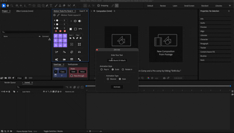

# ZIX-Ani: Kinetic Type Generator for After Effects

Type a sentence, pick a style, click **Animate**. The script builds a finished 1920×1080 kinetic typography composition with staggered words, easing or bounce, motion blur and an exit fade.

Built in ExtendScript (After Effects scripting) as a small tool for motion designers who want a quick, good-looking text animation without keyframing every word by hand.

## What it does

- Opens a small **ScriptUI panel** with a text field, a style choice and a type choice.
- Splits your sentence into words and creates one text layer per word.
- **Auto-fits** the line: every word is measured, and the whole line is scaled down if it would leave the frame.
- Animates the words in one after another (staggered), with opacity, blur and the chosen movement.
- Sets the comp length from the number of words, so nothing is cut off.
- Fades everything out at the end, so the clip does not stop abruptly.
- Adds a subtle handheld camera shake through a parent null layer named `Global`.
- Turns on motion blur for all text layers and for the comp.

## Styles and types

| Style | What the words do |
|---|---|
| **Pop In** | Drop in from slightly above while fading in and un-blurring |
| **Scale** | Grow from 0% to full size while fading in and un-blurring |
| **Rotate In** | Swing in from a tilted angle while fading in and un-blurring |

| Type | Feel |
|---|---|
| **Ease** | Smooth ease-in/ease-out settle |
| **Bounce** | Springy overshoot that settles, driven by an expression |

Every combination (3 styles × 2 types) works with any sentence.

### Bounce controls

With the **Bounce** type, the script adds a null layer called `Physics Adjustment` with three slider controls:

| Slider | Default | Effect |
|---|---|---|
| Amplitude | 2 | How far the overshoot goes |
| Frequency | 2 | How fast it wobbles |
| Decay | 5 | How quickly it settles |

Change them after generating and every word updates at once.

## Install

1. Download `kinetic-type.jsx`.
2. In After Effects: **File > Scripts > Run Script File...** and pick the file.

To keep it docked in the **Window** menu: copy the file into the `Scripts/ScriptUI Panels` folder of your After Effects install, restart After Effects, then open it from the **Window** menu.

If After Effects asks, enable **Preferences > Scripting & Expressions > Allow Scripts to Write Files and Access Network**. (The script itself does not write files, but some setups require this for ScriptUI scripts.)

## Usage

1. Run the script. The **ZIX-Ani** panel opens.
2. Type your text.
3. Choose a **Style** and a **Type**.
4. Click **Animate**. A new composition named after your text appears in the project.
5. Press Ctrl+Z (Cmd+Z) once to undo everything the script created.

If something goes wrong, the script removes the half-built comp and shows the error message.

## Tested on

- After Effects: _fill in your version here_
- OS: _fill in_

## How it works

- Language: **ExtendScript** (an ES3-era JavaScript), with a **ScriptUI** panel.
- Word widths are measured with `sourceRectAtTime()`, and the layout (gaps, scale-to-fit) is computed from those widths.
- Keyframes are created with `setValueAtTime()`, and temporal ease is set through `KeyframeEase`.
- The bounce is an expression applied to position, scale or rotation, reading its values from the controller null.
- Everything runs inside one undo group with `try/catch/finally`.

## Credits

- The bounce expression is adapted from **EZ Inertia**. All credit for the original expression goes to its author. _Add a link to the source here._
- Everything else was written by [Wala Eddine Kara](https://github.com/kw20d).

## Known limits and next steps

- Fixed Full HD, 24 fps output.
- Uses the default font, with no font or color options in the panel yet.
- The layout code is repeated across the three styles. Moving it into one shared function is planned.
- More styles (letter-spacing open, per-character animation) are on the idea list.

## License

MIT. See `LICENSE`.